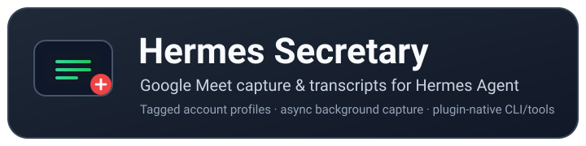

<p align="center">
  
</p>

# Hermes Secretary

**Google Meet secretary for Hermes Agent**

Join meetings under tagged account profiles, capture live captions in the background, and hand clean transcripts back to your agent — without blocking its flow.

**License:** MIT · **Built for:** Hermes Agent · **Capture:** Google Meet live captions · **Profiles:** multi-account (`./secret/<account>/`) · **Runtime:** Python + Playwright · **Prototype:** TypeScript/Node

> **Status:** Early prototype. Caption scraping is best-effort because Google Meet's DOM and selectors change frequently. Only use on meetings you are authorized to join, and follow applicable consent, recording, and transcription rules.

---

## The problem

When an agent joins a Google Meet, the meeting's live captioning lives inside the browser. Capturing it reliably means managing a persistent signed-in session, re-pointing the browser at the meeting, scraping caption DOM as it appears, and pairing that with the agent's own transcript tooling. It's noisy, profile-heavy, and easy to break when Google changes the UI.

## The product

Hermes Secretary wraps that whole loop into a single plugin:

- **Guest join** — no Google sign-in (Google blocks automated sign-in). The bot joins with a display name and the host admits it.
- **Async background capture** — `secretary_join_meet` returns instantly. A dedicated Playwright thread handles the meeting, mutes A/V, enables captions, and scrapes live captions as they render.
- **Poison-to-transcript pipeline** — `secretary_get_transcript` returns captured segments; `secretary_stop_capture` persists a timestamped JSON plus a per-account `latest` snapshot to the Hermes plugin data directory.
- **Hermes-native** — registered as a plugin with tools, a `hermes secretary` CLI, and a session-cleanup hook so captures don't outlive the session.
- **Local-first** — a TypeScript/Playwright runner (`join-meet.ts`) lets you experiment with join and caption scraping in a plain terminal before going through the agent.

## How it works

```text
secretary_join_meet { meet, guest_name, headless:false }
  └─ Playwright persistent context (./secret/<account>/)
     ├─ normalize meet code → https://meet.google.com/<code>
     ├─ handle join screen / lobby
     ├─ mute mic + camera
     ├─ try to enable live captions
     └─ caption DOM → CaptionSegment → transcript
secretary_get_transcript { limit, save:true }
secretary_stop_capture {}            # persists transcript + closes browser
```

## Get started

### 1. Install the plugin

```bash
# local development (supported path)
mkdir -p ~/.hermes/plugins
ln -sfn "$(pwd)" ~/.hermes/plugins/hermes-secretary
hermes plugins enable hermes-secretary
```

> `hermes secretary install` runs `setup.sh` automatically (Python deps + Playwright Chromium + plugin link).

### 2. Join a meeting

```bash
secretary_join_meet {
  "meet": "https://meet.google.com/abc-defg-hij",
  "guest_name": "Hermes Secretary",
  "headless": false
}

secretary_status {}

secretary_get_transcript { "limit": 50, "save": true }

secretary_stop_capture {}
```

### 4. Local standalone runner (no agent needed)

```bash
cd /path/to/hermes-secretary
npm install
npx tsx join-meet.ts https://meet.google.com/abc-defg-hij --account=work
```

## Configuration

| Key | Default | Description |
|---|---|---|
| `secret_dir` | `./secret` | Secret/profile root. Each account uses `<secret_dir>/<account>/`. |
| `default_account` | *(unset)* | Default account tag when `account` is omitted from `secretary_join_meet`. |
| `headless` | `false` | Headless mode. Keep `false` for UI debugging. |
| `capture_source` | `google_meet_captions` | Capture adapter. `whisper_local` is planned, not implemented. |

## Product status & roadmap

- ✅ Plugin registration, tools, and `hermes secretary` CLI
- ✅ Multi-account persistent Chromium profiles
- ✅ Meet join flow (join screen, lobby, A/V mute)
- ✅ Live caption DOM scraping with selector fallbacks
- ✅ Transcript persistence (timestamped + `latest` snapshots)
- ⬜ `whisper_local` audio-tap transcription (planned)
- ⬜ Speaker attribution / diarization
- ⬜ Automated UI tests for Meet's changing caption selectors
- ⬜ Published-package install path (current pip entry point raises on import)

## Documentation

- `AGENTS.md` — agent guide: commands, architecture, tool reference, account/profile rules, pitfalls.

## Security & privacy

- **Keep `./secret/` private.** It holds browser session/profile data for signed-in Google accounts. Gitignored — never commit or share it.
- **Authorized meetings only.** Do not join meetings you are not permitted to.
- **Consent and policy.** Captions and transcripts may contain sensitive content; follow applicable laws, platform rules, and organizational policy.
- **Sensitive data.** Saved transcript JSON may contain meeting content — store and transmit it accordingly.

## Limitations

- **Brittle selectors.** Caption scraping depends on Google Meet DOM/CSS that change without notice. Expect breakage and treat output as best-effort.
- **Caption quality.** Google Meet's live captions are lossy, language/accent dependent, and imperfect with overlapping speakers.
- **Speaker attribution.** Currently best-effort/minimal.
- **No audio path.** `whisper_local` is documented in config but not implemented.

## Development

```bash
# Python compile check
python3 -m py_compile __init__.py secretary_capture.py secretary_cli.py hermes_secretary_plugin.py

# Local setup helper
./setup.sh
./setup.sh --with-node

# Local TS joiner
npx tsx join-meet.ts <meet-code-or-url> --account=work

# Playwright Test format (no runner configured yet)
npx playwright test src/joiner.test.ts
```

## License

MIT — see [LICENSE](LICENSE).
